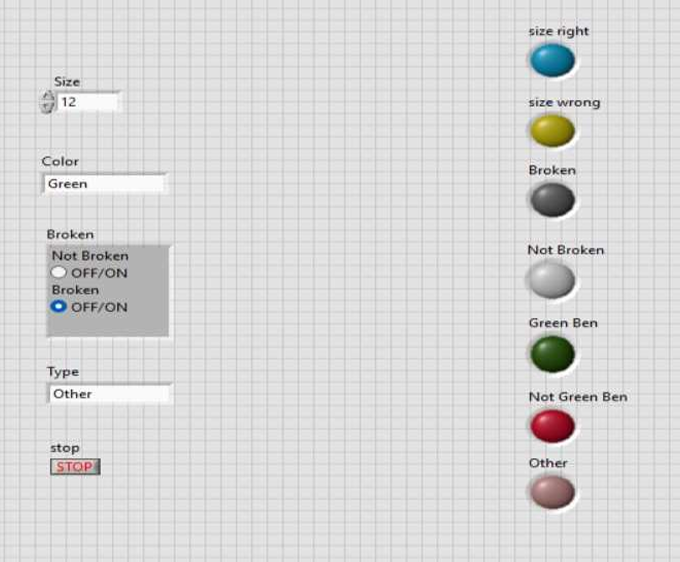
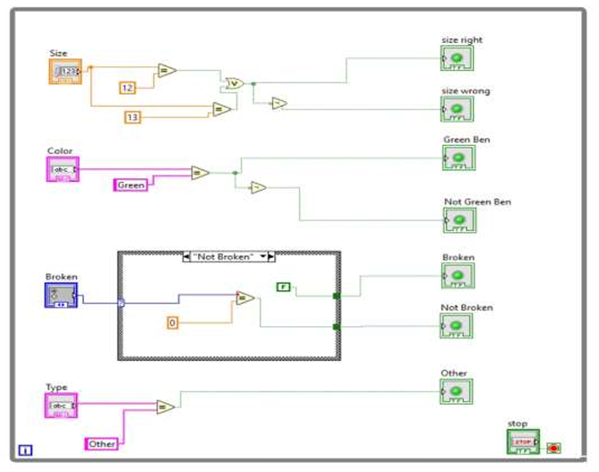

# Coffee Bean Sorting Logic Simulation (NI LabVIEW)

-lightgrey)

> **A real-time virtual instrumentation prototype in NI LabVIEW simulating automated coffee bean grading and sorting decision logic across four parallel quality criteria.**

---

## 📄 Full Technical Report
👉 **[View / Download the Complete Technical Report (PDF)](docs/LabVIEW_Coffee_Sorting_Report.pdf)**

---

## 🎯 Project Overview
Manual coffee bean sorting is slow and prone to human error, directly impacting flavor consistency and market value. This project builds a foundational software simulation in **NI LabVIEW** that models the real-time decision-making pipeline of an automated sorting line—evaluating each bean across four physical parameters and providing instant visual classification through an interactive graphical user interface (GUI).

- **Institution:** Saba University — Faculty of Engineering (Mechatronics Engineering)
- **Author & Sole Technical Developer:** Afnan Aref *(Front Panel GUI Design, Parallel Dataflow Logic & LabVIEW Simulation)*
- **Supervision:** Dr. Marwan & Eng. Zaid Al-Radai

---

## ⚙️ Sorting Criteria & Decision Logic
The virtual instrument (VI) runs continuously inside a **While Loop** using LabVIEW's parallel dataflow execution model (`Read → Process → Update`), processing four independent classification paths simultaneously:

| Quality Criterion | Input Control | Reference Evaluation Logic | LED Indicators (Outputs) |
| :--- | :--- | :--- | :--- |
| **Bean Size** | Numeric Control | Compared against target values `12` or `13` (`Equal?` + `OR` / `NOT`) | `size right` / `size wrong` |
| **Color** | String Control | Exact text match against `"Green"` (`Equal?` + `NOT`) | `Green Bean` / `Not Green Bean` |
| **Physical Condition** | Radio Buttons (`0` / `1`) | Evaluated via a **Case Structure** (`Broken` vs. `Not Broken`) | `Broken` / `Not Broken` |
| **Bean Type** | String Control | Text comparison against `"Other"` (`Equal?`) | `Other` |

---

## 🧩 LabVIEW Block Diagram Architecture
All four evaluation channels execute in parallel within a single master `While Loop`, ensuring immediate output updates until the user triggers the `Stop` control:

---

## 🚀 Future Hardware Scalability
Designed as a modular software foundation, this LabVIEW VI can be directly interfaced with physical industrial hardware (such as DAQ cards, optical/vision sensors, and pneumatic actuators) to transition from virtual simulation to a fully automated sorting conveyor line.

---

## 📌 Note on Repository Scope
*This repository serves as the technical documentation archive for the Mechatronics Systems Design course project, detailing the NI LabVIEW Front Panel design, parallel Block Diagram architecture, and real-time sorting logic.*
